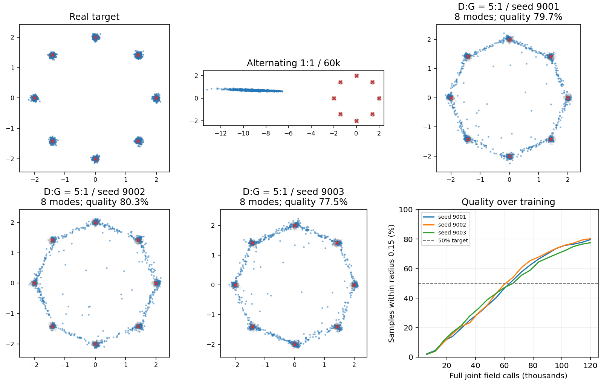

# 第二轮八高斯实验（2026-11-11—2026-11-13）

本轮已经找到能学到八个目标小团的 Adam 训练配置。单独增加训练次数、降低梯度惩罚、更换激活函数、增加网络宽度或使用交替1:1，均没有解决终点覆盖失败；在宽度128、ReLU、lambda0.1的相同条件下，将判别器与生成器更新比改成5:1后，三个随机种子都能覆盖八团。它说明当前配置的训练配合很重要，不能把此前失败直接归因于四种优化算法本身。

## 三种子最终结果

每条轨迹总计120,000次完整联合场计算，G更新20,000次、D更新100,000次。三个120k目录分别延续已有60k父运行，是三条轨迹的延长，不是新增三个独立初始化。

| seed | 终点覆盖 | 终点合格率 | 最近目标中心平均距离 | 最后5个检查点最低覆盖 | 最后5个检查点最低合格率 |
|---|---:|---:|---:|---:|---:|
| 9001 | 8/8 | 79.69% | 0.1315 | 8/8 | 73.54% |
| 9002 | 8/8 | 80.27% | 0.1283 | 8/8 | 73.63% |
| 9003 | 8/8 | 77.54% | 0.1386 | 8/8 | 69.73% |

终点合格率均值为 **79.17%**，种子间样本标准差为 **1.44个百分点**。真实目标采样的合格率约99%，平均距离约0.062。覆盖8团并不等于完全学到目标分布，小团间仍可能残留连接点；该指标也不能排除团间比例或团内形状误差。



## 诊断过程

所有训练使用 Adam，下面不是四种优化器排名。每一次完整联合场计算仍然求两边梯度；交替训练只应用当前玩家的梯度，未应用的计算也计入预算。

| 配置目录 | 完整场计算 | G / D 实际更新数 | 终点覆盖 | 终点合格率 |
|---|---:|---:|---:|---:|
| adam_duration | 30,000 | 30,000 / 30,000 | 0/8 | 0.00% |
| adam_gp01 | 30,000 | 30,000 / 30,000 | 0/8 | 0.24% |
| adam_relu_gp10 | 30,000 | 30,000 / 30,000 | 0/8 | 0.00% |
| adam_relu_gp01 | 30,000 | 30,000 / 30,000 | 0/8 | 0.20% |
| adam_relu_h128_gp01 | 30,000 | 30,000 / 30,000 | 0/8 | 0.00% |
| adam_alternating_d1_h128 | 60,000 | 30,000 / 30,000 | 0/8 | 0.00% |
| adam_alternating_d5_h128 | 60,000 | 10,000 / 50,000 | 8/8 | 46.53% |

原Softplus/宽度32是`adam_duration`；`adam_gp01`只降低lambda；`adam_relu_gp10`只改D激活函数；`adam_relu_gp01`组合这两项；`adam_relu_h128_gp01`在后者基础上增加G、D宽度。交替1:1和5:1均固定宽度128、ReLU、lambda0.1、lr0.0001、batch64。

冻结失败检查点的G，只让D再训练2,000次后，独立评估流上的`D(real)-D(fake)`从-0.2036变为31.5041，G权重哈希未改变。这证明D能够重新排序这组真实／生成样本，支持检查critic追踪的诊断方向；分数幅度受惩罚强度影响，不作为生成质量或真实Wasserstein距离。

## 结论的范围

- 此轮建立的是 **Adam交替训练参考基线**。共同的四优化器同步训练器保持原有定义，四法的新一轮公平比较尚未完成。
- 同步30k和交替1:1的60k具有相同玩家更新数，但后者的两边使用相继的独立新批次，不能单独把差异归因于更新顺序。交替1:1与5:1的60k具有相同完整场预算，但更新次数分配不同。
- 60k三种子终点合格率为46.53%、49.27%、47.12%，尚未达到预定50%目标。由于曲线持续改善，三者均固定参数延长到120k；延长决策用过这三条曲线，因此120k结果属于探索性重复，不是未见种子的最终确认。
- 这是二维合成数据实验。CIFAR-10图像训练及FID/KID尚未执行；二维改善不能直接当作图像质量结论。CPU并行时的耗时不用于优化器速度排名。

## 文件与复现

- [实验协议及事前决策](PROTOCOL.md)、[汇总CSV](summary.csv)、[检查点CSV](checkpoints.csv)、[末段稳定性核验](final_validation.json)。
- [逐次配置、训练日志、生成点和延续关系](runs/)、[判别器冻结诊断](critic_probes/)、[测试记录](tests.txt)。
- [全部终点散点图](samples.png)、[全部检查点曲线](progress.png)、[文件哈希](artifact_hashes.json)、[源代码版本](source_versions.json)。

从仓库根目录执行：

```bash
python -m pytest -q
# 五个同步对照，逐一运行（各30k完整场计算）。
python -m ganopt.train --config configs/round2/adam_duration.json --output runs/round2/adam_duration
python -m ganopt.train --config configs/round2/adam_gp01.json --output runs/round2/adam_gp01
python -m ganopt.train --config configs/round2/adam_relu_gp10.json --output runs/round2/adam_relu_gp10
python -m ganopt.train --config configs/round2/adam_relu_gp01.json --output runs/round2/adam_relu_gp01
python -m ganopt.train --config configs/round2/adam_relu_h128_gp01.json --output runs/round2/adam_relu_h128_gp01
python -m experiments.critic_tracking_probe --checkpoint runs/round2/adam_relu_gp01/checkpoint.pt --output results/round2/critic_probes/adam_relu_gp01
python -m experiments.alternating_reference --config configs/round2/adam_alternating_d1_h128.json --output runs/round2/adam_alternating_d1_h128
python -m experiments.alternating_reference --config configs/round2/adam_alternating_d5_h128.json --output runs/round2/adam_alternating_d5_h128
python -m experiments.alternating_reference --config configs/round2/adam_alternating_d5_h128_s9002.json --output runs/round2/adam_alternating_d5_h128_s9002
python -m experiments.alternating_reference --config configs/round2/adam_alternating_d5_h128_s9003.json --output runs/round2/adam_alternating_d5_h128_s9003
python -m experiments.extend_alternating --parent runs/round2/adam_alternating_d5_h128 --output runs/round2/adam_alternating_d5_h128_s9001_120k --budget 120000
python -m experiments.extend_alternating --parent runs/round2/adam_alternating_d5_h128_s9002 --output runs/round2/adam_alternating_d5_h128_s9002_120k --budget 120000
python -m experiments.extend_alternating --parent runs/round2/adam_alternating_d5_h128_s9003 --output runs/round2/adam_alternating_d5_h128_s9003_120k --budget 120000
python -m experiments.collect_round2 --runs runs/round2 --output results/round2
python -m experiments.report_round2 --results results/round2
```

重新训练时使用空输出目录。checkpoint保存在本地`runs/`，仓库保留配置、CSV和小型生成点文件。首批四个30k对照的10k临时输出未永久保留，原始轨迹使用实际保留的每3k检查点。初始交替运行使用的驱动已保存为`evidence/round2/alternating_reference_at_run.py`；后续版本只修复断点恢复时CSV可能超前的问题，不改变正常连续运行的数值更新。
