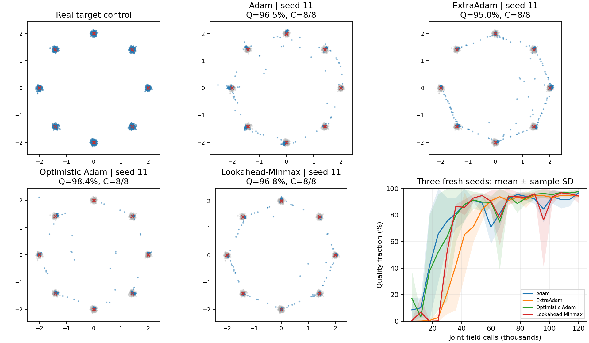

# 第三轮：四优化器同步比较

四法均使用联合同步1:1、宽度128、ReLU、GP=0.1及相同数据流；是继承的WGAN-GP变体，不是原论文基准复现。每条轨迹120,000次联合场调用；每次包含G、D偏导。ExtraAdam每次接受更新用两次调用，故接受60,000步，其余120,000步。调参仅用seed9001及三档学习率，依末5检查点覆盖、合格率、距离顺序选择后冻结，再运行新种子11/22/33。

| 方法 | 冻结LR | 终点覆盖/8 | 终点合格率% | 终点平均距离 | 末5平均合格率% |
|---|---:|---:|---:|---:|---:|
| Adam | 0.001 | 8.00±0.00 | 96.71±0.17 | 0.0714±0.0111 | 91.73±3.29 |
| ExtraAdam | 0.001 | 8.00±0.00 | 94.35±0.95 | 0.0831±0.0097 | 94.34±0.76 |
| Optimistic Adam | 0.001 | 8.00±0.00 | 97.64±0.72 | 0.0682±0.0123 | 96.60±1.13 |
| Lookahead-Minmax | 0.001 | 8.00±0.00 | 94.35±5.15 | 0.0572±0.0138 | 91.39±7.73 |

±为三种子间样本标准差。末5为96k至120k、间隔6k；合格半径严格小于0.15，每团至少21/2048个合格点算覆盖。下表波动标准差沿各种子末5个检查点计算，不能单凭波动小认定训练稳定；最低覆盖取三种子合计15个末段检查点。选中学习率是三档候选内的结果，且均位于候选上界，不代表充分搜索后的最优值。

| 方法 | 末5合格率波动SD：11 / 22 / 33（百分点） | 15点最低覆盖 | 15点最低合格率 |
|---|---:|---:|---:|
| Adam | 6.06 / 9.49 / 2.27 | 8/8 | 74.02% |
| ExtraAdam | 1.45 / 1.47 / 1.26 | 8/8 | 91.31% |
| Optimistic Adam | 1.15 / 2.48 / 1.33 | 8/8 | 92.53% |
| Lookahead-Minmax | 0.52 / 26.64 / 4.49 | 4/8 | 35.25% |



四法均展示预先固定的seed11终点，包含全部2048点；坐标按全数据扩展。真实对照复用收集器的BatchStream。曲线为三种子均值±样本SD，阴影按百分比范围0–100%截取。完整12项结果均保留，未用最佳检查点替代终点。覆盖和合格率不能充分评价团内分布形状。这是三种子的探索性比较，不保证普遍收敛或统计显著性；并行CPU耗时不作速度排名。

第二轮Adam交替5:1参考合格率为79.17%±1.44个百分点，属于不同训练条件，不纳入本轮均值或排名；见[原结果](../round2/README.md)和[原CSV](../round2/summary.csv)。

[设计](../../docs/round3-study-design.md)、[冻结协议](protocol_freeze.json)、[调参](tuning_summary.csv)、[12项结果](reporting_summary.csv)、[全部检查点](reporting_checkpoints.csv)、[逐次文件](runs/reporting/)、[独立核验](final_validation.json)、[文件哈希](artifact_hashes.json)。

从仓库根目录在空`runs/round3`下复现；中断后对对应`run-one`加`--resume`：

```bash
python -m experiments.run_round3 prepare
for c in runs/round3/configs/tuning/*.json; do python -m experiments.run_round3 run-one --config "$c"; done
python -m experiments.run_round3 freeze
for c in runs/round3/configs/reporting/*.json; do python -m experiments.run_round3 run-one --config "$c"; done
python -m experiments.run_round3 collect --phase tuning
python -m experiments.run_round3 collect --phase reporting
python -m experiments.report_round3 --results results/round3
```

本次报告环境为Linux，CUDA检测为`False`；当前Linux不能写入本机D盘，未完成CIFAR-10训练或FID/KID。请在Windows运行以下下载、校验命令，目标固定为`D:\ESTR3108\project\CIFAR-10\dataset`；详见[本机步骤](../../docs/cifar10-windows-zh.md)及[配置](../../configs/windows/cifar10_pilot.json)。

```powershell
py -3 scripts/prepare_cifar10.py --root "D:\ESTR3108\project\CIFAR-10\dataset"
py -3 scripts/prepare_cifar10.py --verify-only
```
